# STM32串口通信综合实验

[TOC]

> **AI 辅助说明**：本次实验利用 AI 帮我理解了串口原理、排查代码报错、解析实验现象。然后自己独立完成了硬件接线、程序调试、仿真操作、实验观测与数据分析等。

## 前言

​        串口 UART 是嵌入式最基础、最常用的异步串行通信接口。本次实验从底层串口协议、电平标准入手，先完成两台电脑之间基于 USB 转串口模块的文件传输，再基于 STM32F103，使用 HAL 库依次实现**轮询串口收发、串口中断收发、DMA 串口高速发送**，最后在无示波器的条件下，使用 Keil 内置 Logic Analyzer 软件仿真抓取串口波形，分析时序并计算波特率。

## 基础一、串口协议、电平标准与 CH340 模块原理

### 1. UART 串口协议基础

UART（通用异步收发器），异步通信不需要同步时钟，依靠双方约定**波特率**完成数据解析。 一帧标准串口帧结构：**1 位起始位（低电平） + 8 位数据位 + 0 位校验位 + 1 位停止位（高电平）**，本实验配置：115200bps，8N1。

- 波特率：每秒传输比特数量，115200 代表每秒发送 115200 个 bit；单个 bit 位时间 \(T=1/115200≈87us\)。

### 2. RS232、RS485 与 TTL 电平区别

1. **TTL 电平（STM32 芯片引脚电平）** 

   高电平：3.3V；低电平：0V。通信距离很短，仅板内、短距离杜邦线连接，是单片机内部电平。

2. **RS-232 电平** 

   逻辑 1：-3V ~ -15V；逻辑 0：+3V ~ +15V。电平正负反转，抗干扰能力强，传输距离可达 15 米，**不能直接和 STM32 TTL 引脚直连，会烧毁芯片**。

3. **RS-485 电平** 

   使用差分信号传输，依靠 A、B 两根线电压差判断逻辑，抗干扰能力极强，最远传输千米级，适合工业远距离通信。

### 3. CH340 USB/TTL 转 232 模块原理

CH340 是 USB 转串口芯片，电脑没有原生串口，依靠 CH340 实现 USB ↔ TTL 串口协议转换。

- 电脑 USB 口 → CH340 芯片，将 USB 协议数据包转换成 TTL 串口信号；

- 模块引出 TX/RX/GND/VCC 引脚，输出 TTL 电平，可以直接连接 STM32 的 USART 引脚；

- 部分 CH340 模块同时集成 RS232 电平转换芯片，可以输出标准 RS232 信号。

  ## 基础二、两台笔记本串口文件传输（USB/TTL 转 RS232 模块）

  ### 硬件接线

  电脑 A <--> CH340 模块 A；电脑 B <--> CH340 模块 B 

  接线规则：模块 A 的 TX 接模块 B 的 RX；模块 A 的 RX 接模块 B 的 TX；**两个模块 GND 必须相连**。

  ### 1. 文件大小、波特率、传输时间关系

  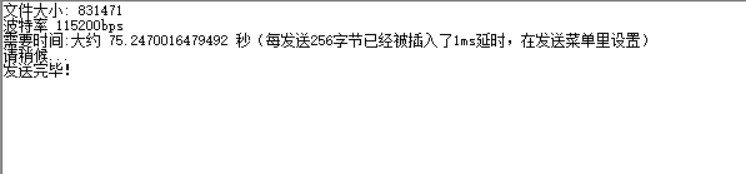
  
  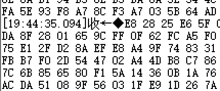
  
  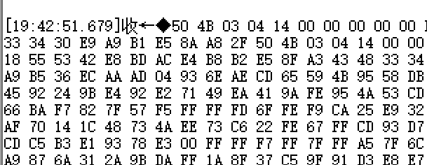

  1. 理论最小传输时间
  
  每字节需要传输 10bit，总比特数量：
  $$
  Bit_{total}=831471 \times 10 = 8314710\ \text{bit}\
  $$

  $$
  T_{理论最小}=\frac{Bit_{total}}{Baud}=\frac{8314710}{115200}\approx 72.18\ \text{s}\
  $$

  

  2. SSCOM 预估传输时间

  每 256 字节插入 1ms 延时，分组数量：
  $$
  N=\lceil \frac{831471}{256} \rceil=\lceil3247.93\rceil=3248\ \text{组}\
  $$
  附加延时总时长：
  $$
  T_{delay}=3248\times1\ \text{ms}=3.248\ \text{s}\
  $$
  预估总时间：
  $$
  T_{预估}=72.18 + 3.248 \approx75.43\ \text{s}\
  $$
  软件界面显示预估时间 75.247s，二者基本一致，差异来自小数取整。

  3. 实际传输时间

  $$
  T_{实际}=103.415\ \text{s}\
  $$

  4.三者之间的关系

  - **波特率固定不变时**：文件字节大小越大，传输时间越长；传输时间与文件大小**成正比**。
  - **文件大小固定不变时**：波特率越高，传输时间越短；传输时间与波特率**成反比**。
  - 理论公式只考虑硬件比特传输。**实际工程中**，总传输时间还会叠加软件分包延时、USB 转串口驱动、操作系统缓冲区调度等额外耗时，所以实际时间一定大于理论计算时间。

  ### 2. 只接 TX-RX、RX-TX，不接 GND 地线，能否正常传输？

  **不能稳定工作。** 原因：串口通信依靠参考地判断高低电平。两个设备没有共地，两边电压参考基准不一致，TX 输出的高低电平会出现电位偏移，接收端无法正确识别 0/1 逻辑电平。短距离、模块供电隔离程度高的场景偶尔会偶然收到乱码，但传输大文件一定会大量出错、丢包，文件传输失败。共地是串口通信的必要条件。

  ## 任务一：STM32CubeMX+HAL 库 USART1 基础收发实验

  实验目标：USART1，波特率 115200，8N1。 ① STM32 循环发送`hello windows！`，观察有无延时对上位机接收丢包的影响 ② 上位机发送`#`暂停发送；发送`*`恢复发送。
  
  ### 1. CubeMX 配置详细步骤
  
  1. 选择芯片 STM32F103C8T6；RCC 配置 HSE 外部高速晶振。
  
  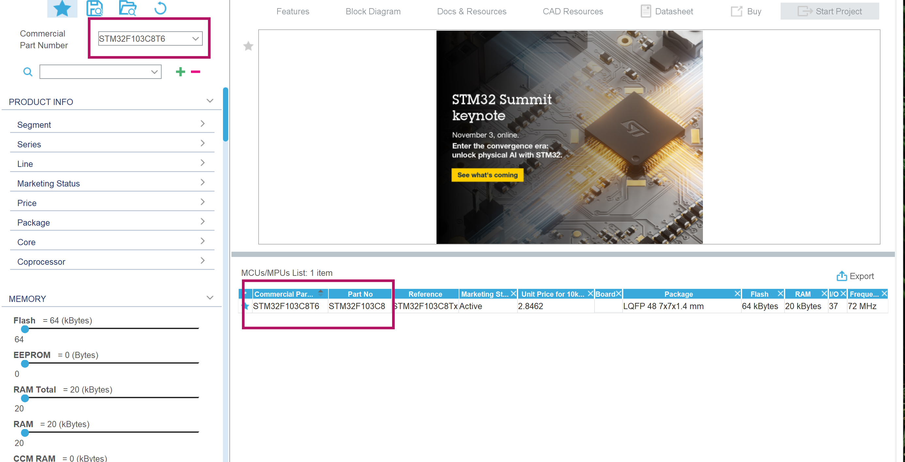
  
  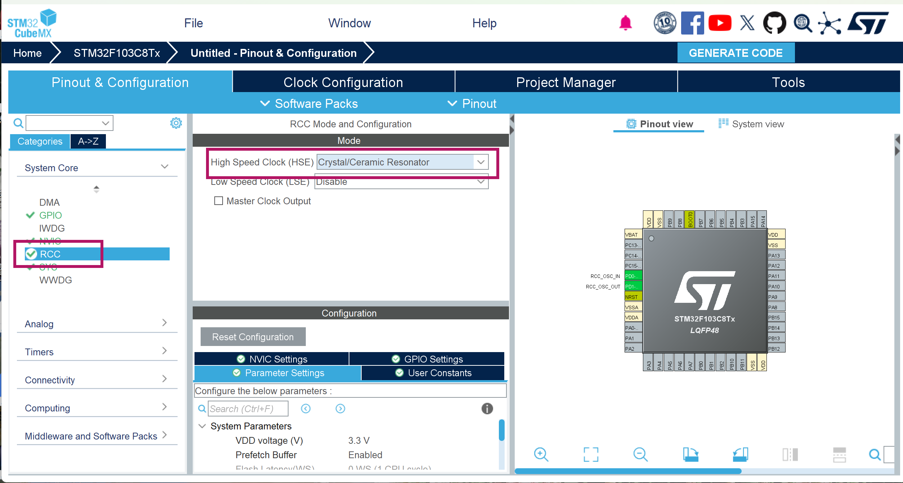
  
  2.SYS：Debug 选择 Serial Wire（下载调试用）。
  
  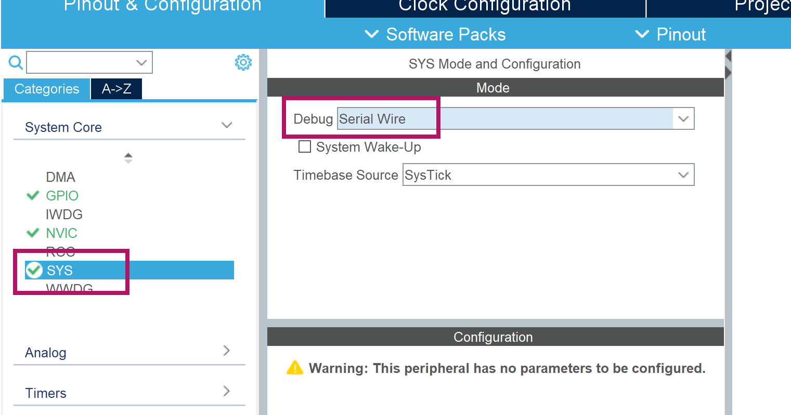
  
  3.USART1 配置：Mode 选择 Asynchronous（异步）；波特率 115200；8 位数据；无校验；1 停止位。
  
  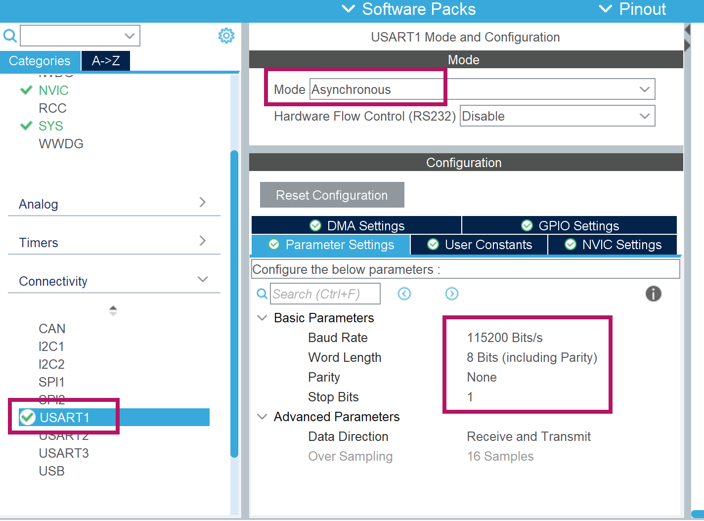
  
  4.引脚配置：PA9 设置为 USART1_TX；PA10 设置 USART1_RX。
  
  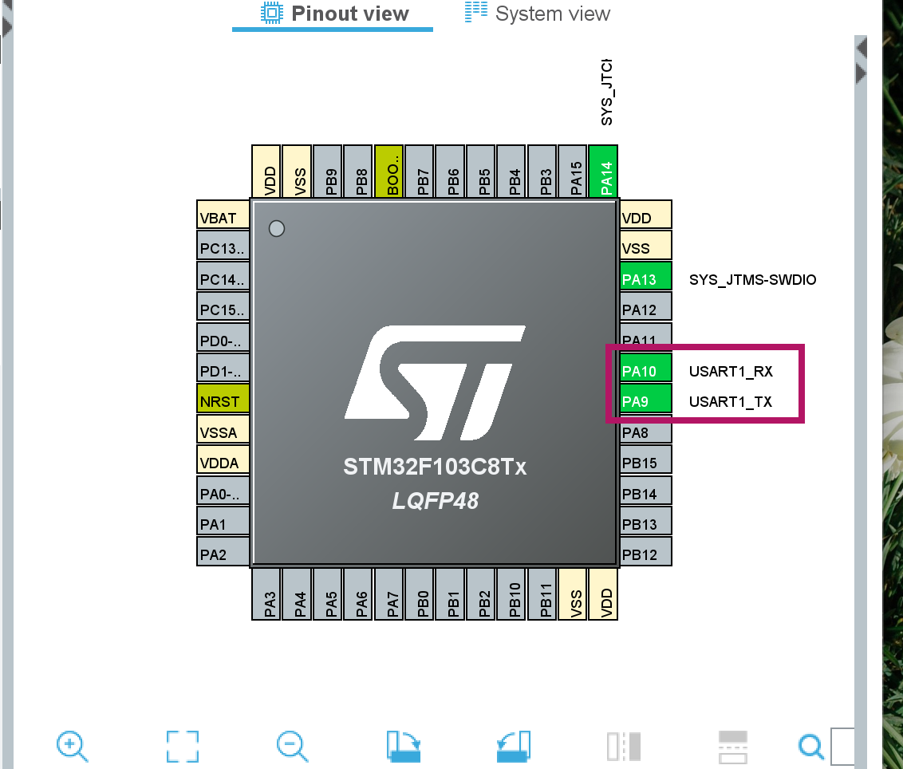
  
  5.NVIC：开启 USART1 全局中断。
  
  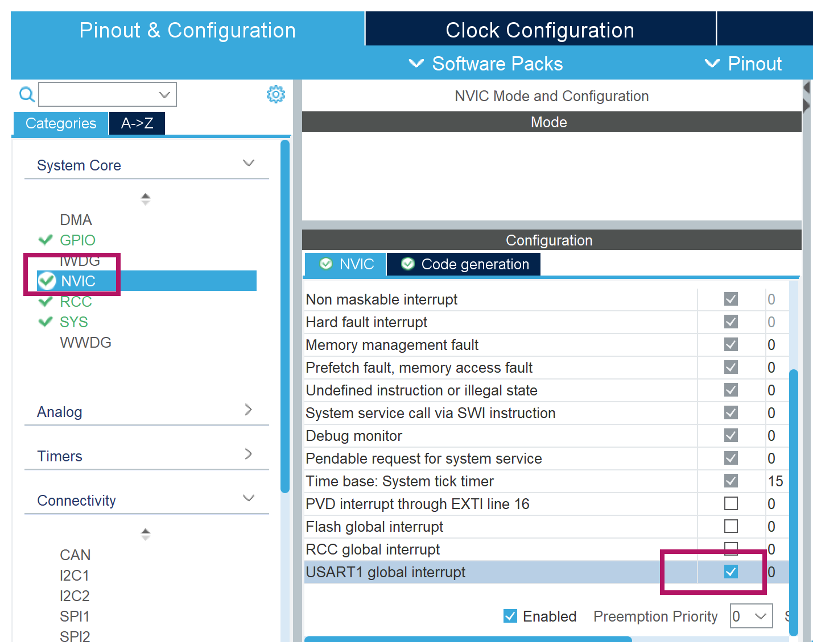
  
  6.打开时钟树，选择HSE（外部高速晶振），然后选择PLL倍频，把系统时钟配置到72MHz
  
  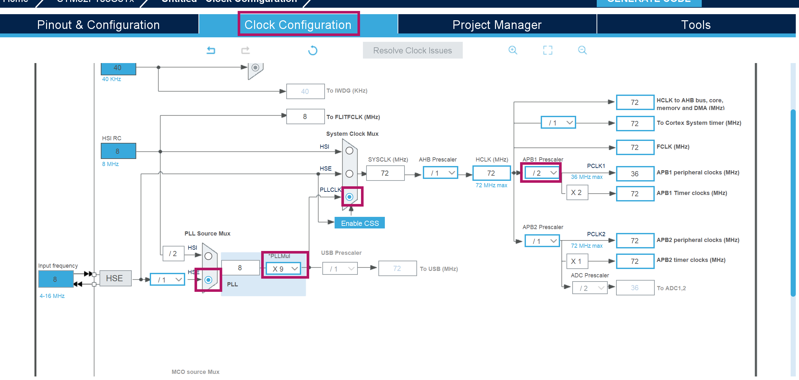
  
  1. 生成工程：选择 MDK-ARM，勾选生成 HAL 库代码，生成项目。
  
     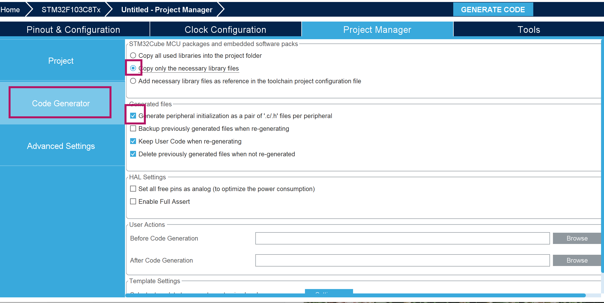
  
  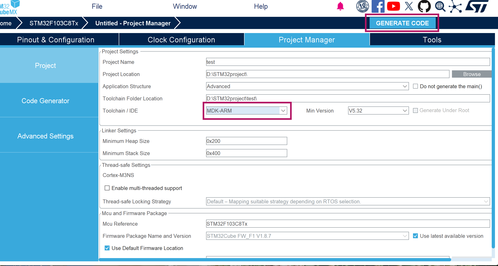
  
  ### 2. 完整代码
  
  ```c
  /* USER CODE BEGIN Header */
  /**
    ******************************************************************************
    * @file           : main.c
    * @brief          : Main program body
    ******************************************************************************
    */
  /* USER CODE END Header */
  #include "main.h"
  #include "gpio.h"
  #include "usart.h"
  
  void SystemClock_Config(void);
  
  /* USER CODE BEGIN PV */
  uint8_t rec_data;
  uint8_t send_en = 1;  //发送使能标志：1允许发送，0停止
  char send_buf[] = "hello windows! \r\n";
  /* USER CODE END PV */
  
  int main(void)
  {
    HAL_Init();
    SystemClock_Config();
    MX_GPIO_Init();
    MX_USART1_UART_Init();
  
    /* USER CODE BEGIN 2 */
    HAL_UART_Receive_IT(&huart1, &rec_data, 1); //开启串口接收中断
    /* USER CODE END 2 */
  
    while (1)
    {
      /* USER CODE BEGIN WHILE */
      if(send_en == 1)
      {
          //【阻塞发送】CPU停留在此，等整串发完才返回，任务一要求！
          HAL_UART_Transmit(&huart1, (uint8_t *)send_buf, sizeof(send_buf)-1, 100);
          HAL_Delay(500);
      }
      /* USER CODE END WHILE */
    }
  }
  
  //串口接收中断回调函数
  void HAL_UART_RxCpltCallback(UART_HandleTypeDef *huart)
  {
    if(huart->Instance == USART1)
    {
      if(rec_data == '#')
      {
          send_en = 0; //收到#，停止发送
      }
      else if(rec_data == '*')
      {
          send_en = 1; //收到*，恢复发送
      }
      HAL_UART_Receive_IT(&huart1, &rec_data, 1); //重新开启下一次接收中断
    }
  }
  
  /**
    * @brief System Clock Configuration
    * @retval None
    */
  void SystemClock_Config(void)
  {
    RCC_OscInitTypeDef RCC_OscInitStruct = {0};
    RCC_ClkInitTypeDef RCC_ClkInitStruct = {0};
  
    RCC_OscInitStruct.OscillatorType = RCC_OSCILLATORTYPE_HSE;
    RCC_OscInitStruct.HSEState = RCC_HSE_ON;
    RCC_OscInitStruct.HSEPredivValue = RCC_HSE_PREDIV_DIV1;
    RCC_OscInitStruct.HSIState = RCC_HSI_ON;
    RCC_OscInitStruct.PLL.PLLState = RCC_PLL_ON;
    RCC_OscInitStruct.PLL.PLLSource = RCC_PLLSOURCE_HSE;
  	RCC_OscInitStruct.PLL.PLLMUL = RCC_PLL_MUL9;
  
  
    if (HAL_RCC_OscConfig(&RCC_OscInitStruct) != HAL_OK)
    {
      Error_Handler();
    }
  
    RCC_ClkInitStruct.ClockType = RCC_CLOCKTYPE_HCLK|RCC_CLOCKTYPE_SYSCLK
                                |RCC_CLOCKTYPE_PCLK1|RCC_CLOCKTYPE_PCLK2;
    RCC_ClkInitStruct.SYSCLKSource = RCC_SYSCLKSOURCE_PLLCLK;
    RCC_ClkInitStruct.AHBCLKDivider = RCC_SYSCLK_DIV1;
    RCC_ClkInitStruct.APB1CLKDivider = RCC_HCLK_DIV2;
    RCC_ClkInitStruct.APB2CLKDivider = RCC_HCLK_DIV1;
  
    if (HAL_RCC_ClockConfig(&RCC_ClkInitStruct, FLASH_LATENCY_2) != HAL_OK)
    {
      Error_Handler();
    }
  }
  
  void Error_Handler(void)
  {
    __disable_irq();
    while (1)
    {
    }
  }
  
  #ifdef USE_FULL_ASSERT
  void assert_failed(uint8_t *file, uint32_t line)
  {
  }
  #endif
  ```
  
  ### 3. 硬件连接
  
  STM32 PA9 (TX) → CH340 RX；STM32 PA10 (RX) → CH340 TX；共 GND。CH340 接电脑 USB。
  
  ### 4. 实验操作步骤
  
  1. Keil 编译工程，下载代码到 STM32。
  2. 电脑打开 XCOM，选择对应 COM 口，波特率 115200，打开串口。
  3. **实验组 1：去掉 HAL_Delay** STM32 无延时循环发送，观察串口助手：大量数据、丢包、乱码、截断。
  
  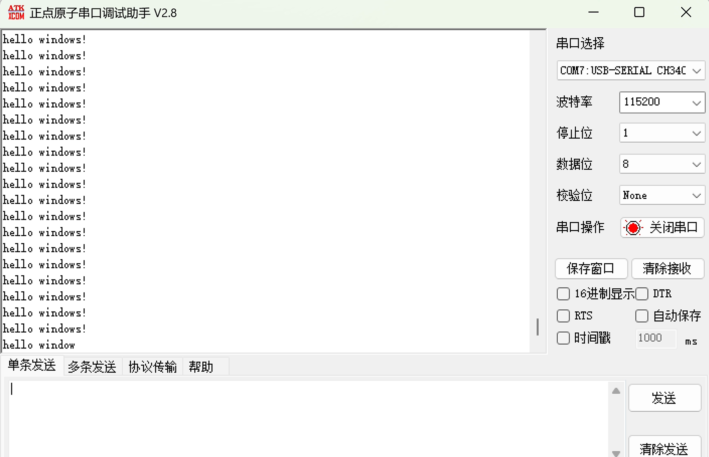
  
  4.**实验组 2：开启 HAL_Delay (500)** 间隔发送，串口助手稳定接收`hello windows!`。
  
  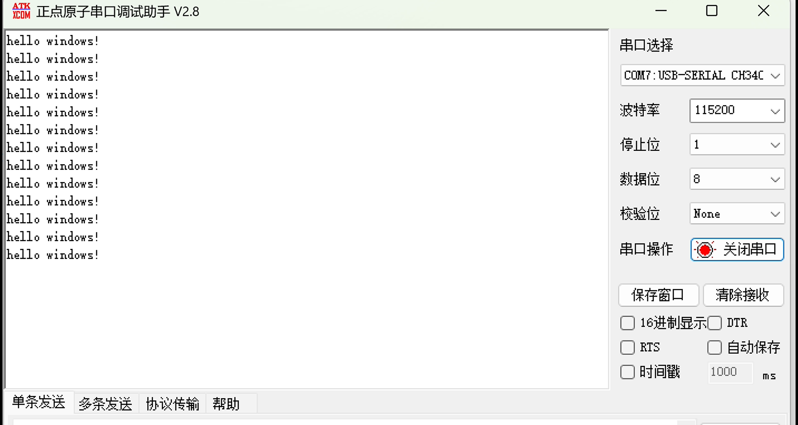
  
  5.串口助手发送`#`，STM32 停止输出；发送`*`恢复输出。
  
  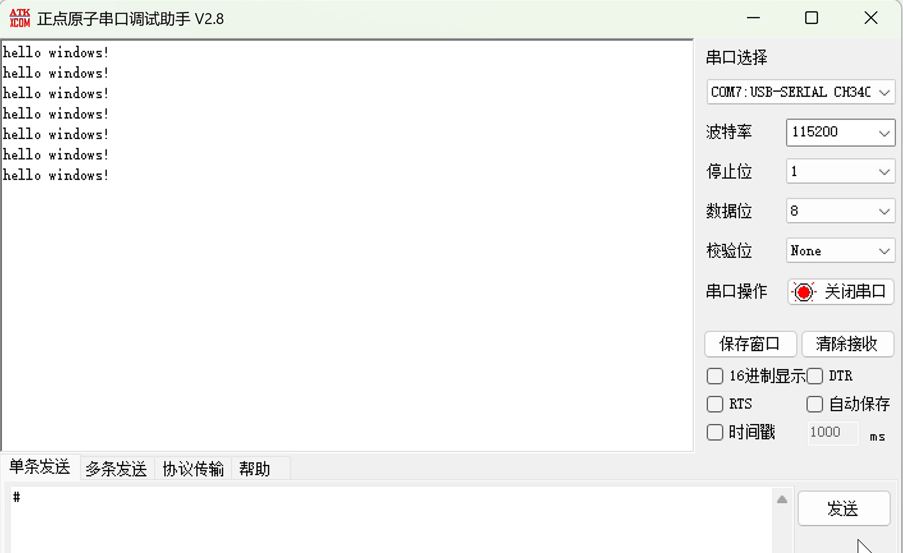
  
  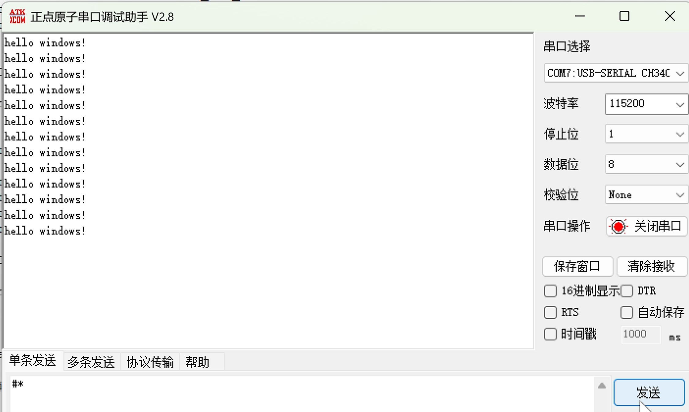
  
  
  
  ## 任务二：（1）串口中断方式实现收发功能
  
  > 原理：中断方式为非阻塞。CPU 不用轮询等待；收到上位机字符自动触发串口中断，在回调函数处理启停标志。发送使用中断方式`HAL_UART_Transmit_IT`。
  
  ### 1. CubeMX 配置
  
  同任务一的配置无需改动
  
  ### 2. 完整代码
  
  ```c
  /* USER CODE BEGIN Header */
  /**
    ******************************************************************************
    * @file           : main.c
    * @brief          : Main program body
    ******************************************************************************
    * @attention
    *
    * Copyright (c) 2026 STMicroelectronics.
    * All rights reserved.
    *
    * This software is licensed under terms that can be found in the LICENSE file
    * in the root directory of this software component.
    * If no LICENSE file comes with this software, it is provided AS-IS.
    *
    ******************************************************************************
    */
  /* USER CODE END Header */
  /* Includes ------------------------------------------------------------------*/
  #include "main.h"
  #include "gpio.h"
  #include "usart.h"
  
  /* Private function prototypes -----------------------------------------------*/
  void SystemClock_Config(void);
  
  /* USER CODE BEGIN PV */
  uint8_t send_flag = 1;   // 1=允许发送，0=暂停发送
  uint8_t rx_data;         // 保存上位机收到的单个字符
  /* USER CODE END PV */
  
  /**
    * @brief  The application entry point.
    * @retval int
    */
  int main(void)
  {
    /* USER CODE BEGIN 1 */
  
    /* USER CODE END 1 */
  
    /* MCU Configuration--------------------------------------------------------*/
  
    /* Reset of all peripherals, Initializes the Flash interface and the Systick. */
    HAL_Init();
  
    /* USER CODE BEGIN Init */
  
    /* USER CODE END Init */
  
    /* Configure the system clock */
    SystemClock_Config();
  
    /* USER CODE BEGIN SysInit */
  
    /* USER CODE END SysInit */
  
    /* Initialize all configured peripherals */
    MX_GPIO_Init();
    MX_USART1_UART_Init();
    /* USER CODE BEGIN 2 */
    // 开启USART1接收中断，接收1个字符
    HAL_UART_Receive_IT(&huart1, &rx_data, 1);
    /* USER CODE END 2 */
  
    /* Infinite loop */
    /* USER CODE BEGIN WHILE */
    while (1)
    {
      if(send_flag == 1)
      {
        // 向上位机发送字符串 hello windows!
        HAL_UART_Transmit(&huart1, (uint8_t *)"hello windows! ", sizeof("hello windows! ")-1, 100);
  
        //====实验对比：去掉这行就是无延时高速发送，会丢包；打开则500ms发送一次====
        HAL_Delay(500);
      }
  
      /* USER CODE END WHILE */
  
      /* USER CODE BEGIN 3 */
    }
    /* USER CODE END 3 */
  }
  
  /**
    * @brief System Clock Configuration
    * @retval None
    */
  void SystemClock_Config(void)
  {
    RCC_OscInitTypeDef RCC_OscInitStruct = {0};
    RCC_ClkInitTypeDef RCC_ClkInitStruct = {0};
  
    /** Initializes the RCC Oscillators according to the specified parameters
    * in the RCC_OscInitTypeDef structure.
    */
    RCC_OscInitStruct.OscillatorType = RCC_OSCILLATORTYPE_HSE;
    RCC_OscInitStruct.HSEState = RCC_HSE_ON;
    RCC_OscInitStruct.HSEPredivValue = RCC_HSE_PREDIV_DIV1;
    RCC_OscInitStruct.HSIState = RCC_HSI_ON;
    RCC_OscInitStruct.PLL.PLLState = RCC_PLL_ON;
    RCC_OscInitStruct.PLL.PLLSource = RCC_PLLSOURCE_HSE;
    RCC_OscInitStruct.PLL.PLLMUL = RCC_PLL_MUL9;
    if (HAL_RCC_OscConfig(&RCC_OscInitStruct) != HAL_OK)
    {
      Error_Handler();
    }
  
    /** Initializes the CPU, AHB and APB buses clocks
    */
    RCC_ClkInitStruct.ClockType = RCC_CLOCKTYPE_HCLK|RCC_CLOCKTYPE_SYSCLK
                                |RCC_CLOCKTYPE_PCLK1|RCC_CLOCKTYPE_PCLK2;
    RCC_ClkInitStruct.SYSCLKSource = RCC_SYSCLKSOURCE_PLLCLK;
    RCC_ClkInitStruct.AHBCLKDivider = RCC_SYSCLK_DIV1;
    RCC_ClkInitStruct.APB1CLKDivider = RCC_HCLK_DIV2;
    RCC_ClkInitStruct.APB2CLKDivider = RCC_HCLK_DIV1;
  
    if (HAL_RCC_ClockConfig(&RCC_ClkInitStruct, FLASH_LATENCY_2) != HAL_OK)
    {
      Error_Handler();
    }
  }
  
  /* USER CODE BEGIN 4 */
  //串口接收中断回调函数
  void HAL_UART_RxCpltCallback(UART_HandleTypeDef *huart)
  {
    if(huart->Instance == USART1)
    {
      if(rx_data == '#')
      {
        send_flag = 0;   //收到#，暂停发送
      }
      else if(rx_data == '*')
      {
        send_flag = 1;   //收到*，恢复发送
      }
      //重新开启中断，等待下一个字符
      HAL_UART_Receive_IT(&huart1, &rx_data, 1);
    }
  }
  /* USER CODE END 4 */
  
  /**
    * @brief  This function is executed in case of error occurrence.
    * @retval None
    */
  void Error_Handler(void)
  {
    /* USER CODE BEGIN Error_Handler_Debug */
    /* User can add his own implementation to report the HAL error return state */
    __disable_irq();
    while (1)
    {
    }
    /* USER CODE END Error_Handler_Debug */
  }
  
  #ifdef USE_FULL_ASSERT
  /**
    * @brief  Reports the name of the source file and the source line number
    *         where the assert_param error has occurred.
    * @param  file: pointer to the source file name
    * @param  line: assert_param error line source number
    * @retval None
    */
  void assert_failed(uint8_t *file, uint32_t line)
  {
    /* USER CODE BEGIN 6 */
    /* User can add his own implementation to report the file name and line number,
       ex: printf("Wrong parameters value: file %s on line %d\r\n", file, line) */
    /* USER CODE END 6 */
  }
  #endif /* USE_FULL_ASSERT */
  ```
  
  ### 3. 实验步骤
  
  1. Keil 编译下载代码到开发板，接线同任务一。
  2. XCOM 打开串口，观察自动输出字符串。
  3. 发送`#`暂停；发送`*`恢复发送。
  
  
  
  
  
  ## 任务二：（2）串口 DMA 高速发送实验
  
  > DMA：直接存储器访问，不需要 CPU 搬运数据，内存直接送到串口外设，适合高速连续大量发送。
  
  ### 1. CubeMX DMA 配置步骤
  
  1. 进入 USART1 配置页面，添加 DMA，选择 TX 方向：Memory to Peripheral（内存到外设）。
  2. DMA 模式：Normal 正常模式 / Circular 循环模式；数据宽度 Byte。
  
  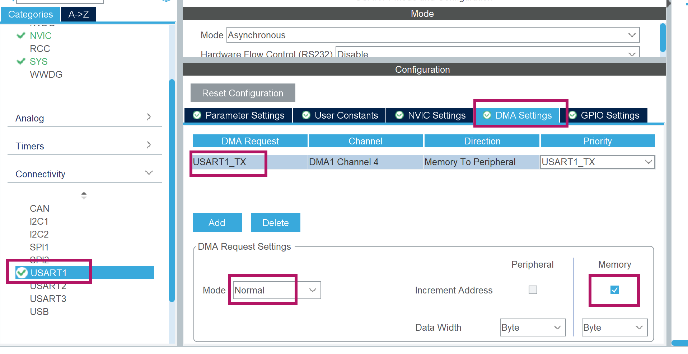
  
  3.开启 USART1 全局中断，生成工程。
  
  ### 2. 完整代码
  
  ```c
  /* USER CODE BEGIN Header */
  /**
    ******************************************************************************
    * @file           : main.c
    * @brief          : Main program body
    ******************************************************************************
    */
  /* USER CODE END Header */
  #include "main.h"
  #include "gpio.h"
  #include "usart.h"
  #include "dma.h"
  
  void SystemClock_Config(void);
  
  /* USER CODE BEGIN PV */
  uint8_t rec_data;
  uint8_t send_en = 1;        //发送使能：1允许，0停止
  uint8_t tx_finish_flag = 1; //DMA发送完成标志，1代表空闲可以发下一包
  char send_buf[] = "hello windows!";
  /* USER CODE END PV */
  
  int main(void)
  {
    HAL_Init();
    SystemClock_Config();
    MX_GPIO_Init();
    MX_DMA_Init();
    MX_USART1_UART_Init();
  
    /* USER CODE BEGIN 2 */
    HAL_UART_Receive_IT(&huart1, &rec_data, 1); //开启接收中断
    /* USER CODE END 2 */
  
    while (1)
    {
      /* USER CODE BEGIN WHILE */
      if(send_en == 1 && tx_finish_flag == 1)
      {
        tx_finish_flag = 0; //标记DMA正在发送，禁止重复触发DMA
        //DMA发送，非阻塞，函数立刻返回，DMA硬件搬运数据
        HAL_UART_Transmit_DMA(&huart1, (uint8_t *)send_buf, sizeof(send_buf)-1);
      }
      HAL_Delay(500);
      /* USER CODE END WHILE */
    }
  }
  
  //串口接收中断回调函数：解析启停指令
  void HAL_UART_RxCpltCallback(UART_HandleTypeDef *huart)
  {
    if(huart->Instance == USART1)
    {
      if(rec_data == '#')
      {
        send_en = 0;  // # 停止发送
      }
      else if(rec_data == '*')
      {
        send_en = 1;  // * 恢复发送
      }
      HAL_UART_Receive_IT(&huart1, &rec_data, 1); //重新开启接收
    }
  }
  
  //DMA发送完成回调函数
  void HAL_UART_TxCpltCallback(UART_HandleTypeDef *huart)
  {
    if(huart->Instance == USART1)
    {
      tx_finish_flag = 1; //DMA传输完成，标记空闲，可以发送下一组
    }
  }
  
  /**
    * @brief System Clock Configuration
    * @retval None
    */
  void SystemClock_Config(void)
  {
    RCC_OscInitTypeDef RCC_OscInitStruct = {0};
    RCC_ClkInitTypeDef RCC_ClkInitStruct = {0};
  
    RCC_OscInitStruct.OscillatorType = RCC_OSCILLATORTYPE_HSE;
    RCC_OscInitStruct.HSEState = RCC_HSE_ON;
    RCC_OscInitStruct.HSEPredivValue = RCC_HSE_PREDIV_DIV1;
    RCC_OscInitStruct.HSIState = RCC_HSI_ON;
    RCC_OscInitStruct.PLL.PLLState = RCC_PLL_ON;
    RCC_OscInitStruct.PLL.PLLSource = RCC_PLLSOURCE_HSE;
    RCC_OscInitStruct.PLL.PLLMUL = RCC_PLL_MUL9;
  
  
    if (HAL_RCC_OscConfig(&RCC_OscInitStruct) != HAL_OK)
    {
      Error_Handler();
    }
  
    RCC_ClkInitStruct.ClockType = RCC_CLOCKTYPE_HCLK|RCC_CLOCKTYPE_SYSCLK
                                |RCC_CLOCKTYPE_PCLK1|RCC_CLOCKTYPE_PCLK2;
    RCC_ClkInitStruct.SYSCLKSource = RCC_SYSCLKSOURCE_PLLCLK;
    RCC_ClkInitStruct.AHBCLKDivider = RCC_SYSCLK_DIV1;
    RCC_ClkInitStruct.APB1CLKDivider = RCC_HCLK_DIV2;
    RCC_ClkInitStruct.APB2CLKDivider = RCC_HCLK_DIV1;
  
    if (HAL_RCC_ClockConfig(&RCC_ClkInitStruct, FLASH_LATENCY_2) != HAL_OK)
    {
      Error_Handler();
    }
  }
  
  void Error_Handler(void)
  {
    __disable_irq();
    while (1)
    {
    }
  }
  
  #ifdef USE_FULL_ASSERT
  void assert_failed(uint8_t *file, uint32_t line)
  {
  }
  #endif
  ```
  
  ### 3. 实验步骤
  
  1. 编译下载，打开 XCOM 串口助手。
  2. 观察串口高速连续输出数据；可提高波特率测试高速传输。
  
  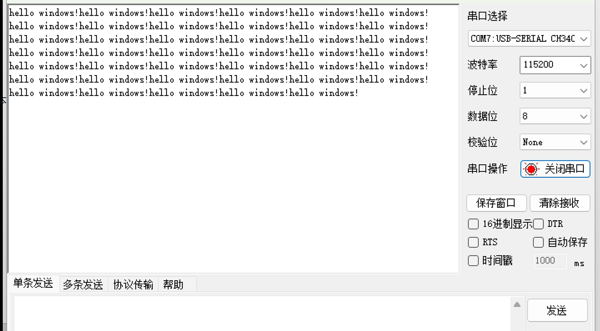
  
  > 原理说明：DMA 接管数据搬运，CPU 在发送同时可以运行其他任务，相比中断方式，CPU 占用率更低，适合大批量高速传输。
  
  ------
  
  ## 任务三：Keil 软件逻辑分析仪观任务二（1）测串口输出波形
  
  ### 1. 说明
  
  PA9 配置为 USART1_TX 复用外设，新版 Keil 软件仿真**不会更新 GPIOA->ODR 寄存器**，直接监视`GPIOA->ODR.9`波形为一条直线，无法获取真实引脚波形。 方案：在代码内用全局变量`sim_uart_bit`模拟 UART 比特流，Logic Analyzer 监视这个全局变量，生成标准串口帧波形。
  
  ### 2.Keil 仿真详细操作步骤
  
  1. Keil 进入 Debug 仿真模式。
  
  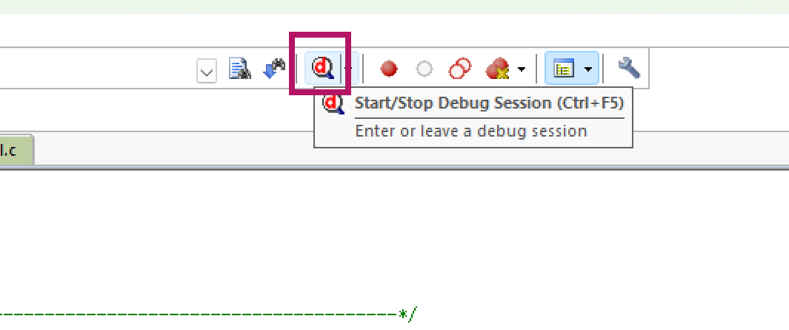
  
  2.顶部菜单打开：`View → Analysis Windows → Logic Analyzer`。
  
  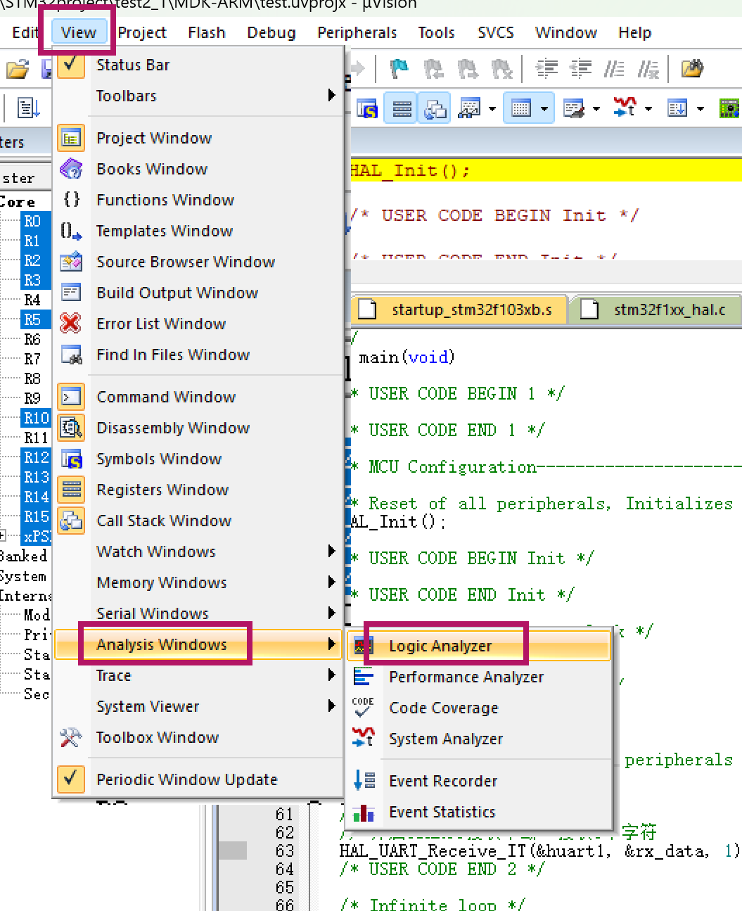
  
  
  
  3.点击 Logic Analyzer 窗口【Setup】，新建信号，填入`sim_uart_bit`，Display Type 选择 Bit。
  
  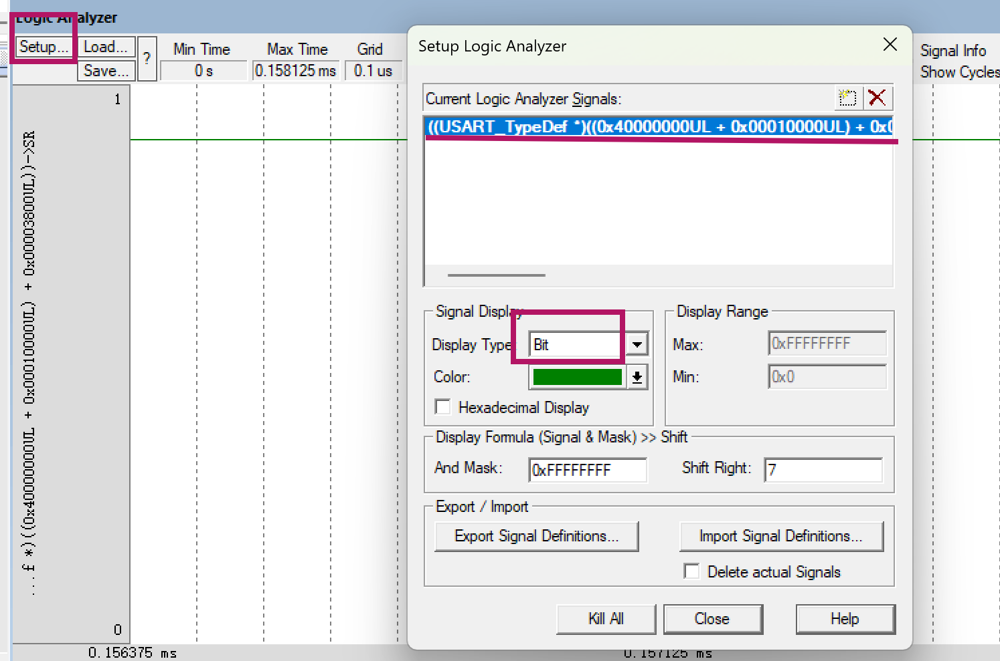
  
  4.点击 Run（F5）运行仿真，等待一段时间后 Stop 停止采集，Logic Analyzer 捕获到完整 UART 帧波形截图（包含起始位、8 个数据位、停止位）。。
  
  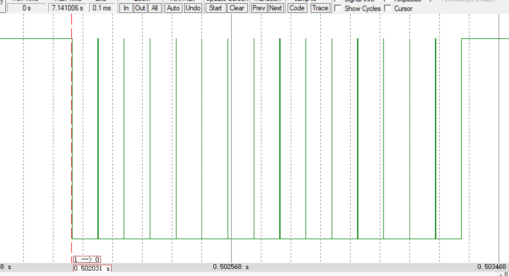
  
  ### 3.波特率计算
  
  1. 使用 Logic Analyzer 光标测量**单个 bit 的时间 T**。
  
     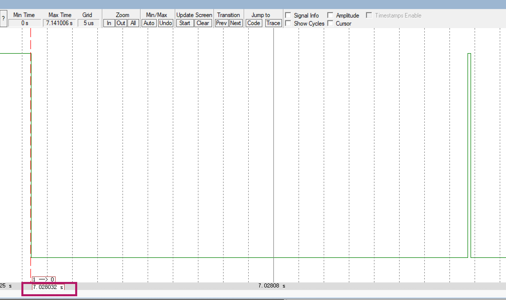
  
     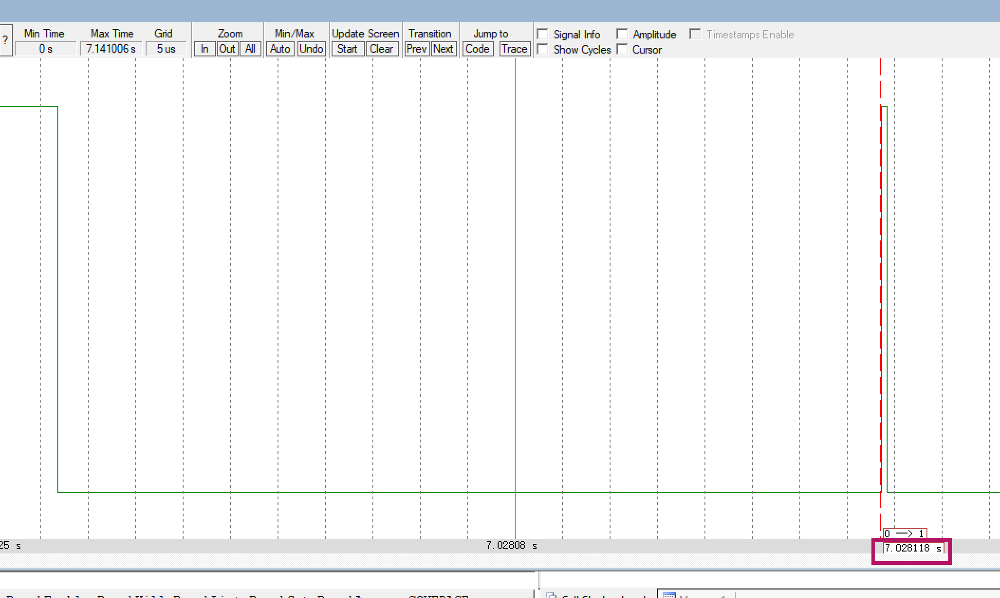
  
  2. ① 位周期 T
     $$
     T = t_2 - t_1 = 7.028140 - 7.028118 = \boldsymbol{0.000022\ s = 22\ \mu s}\
     $$
     ② 波特率计算
     $$
     Baud = \frac{1}{T} = \frac{1}{22\times10^{-6}} \approx \boldsymbol{45454.55\ bit/s}\
     $$
     
  
  ### 4.分析
  
  波特率算出来只有 45454，和 115200 差距很大。HAL_Delay 在仿真的时候不是按照单片机真实晶振计时，仿真跑的快慢取决于电脑 CPU，延时只是简单指令循环模拟，**仿真环境下软件延时完全不能用来精准定时**。
  
  ## 实验总结
  
  此次 STM32 串口综合实验，完成串口文件传输、轮询、中断、DMA 三种串口通信实验以及 Keil 逻辑分析仪 UART 时序观测。实验验证了串口通信 TX-RX 交叉连接、共地的接线要点；对比得知轮询发送会阻塞 CPU，中断方式提升实时性，DMA 传输几乎不占用 CPU，适合高速大批量数据收发。仿真捕获的波形符合 8N1 串口协议时序逻辑，同时发现 Keil 软件仿真存在软件延时计时偏差的固有问题，硬件串口的时序精度更高。本次实验掌握了异步串口通信的工作机制，达到实验目标。
